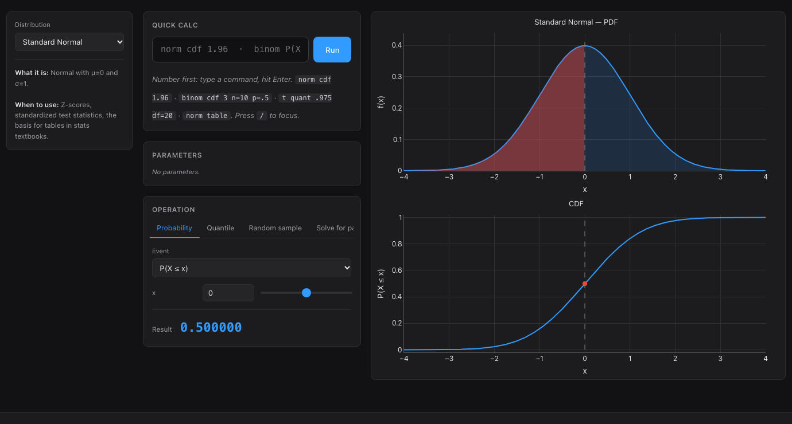

# statiq

**The statistics playground I built so I'd never have to boot Windows for stats class again.**

statiq is an interactive distribution explorer for actually *understanding* probability — not just clicking through a menu in a stats program. Pick a distribution, drag the parameters, and watch the pdf, cdf and quantiles react in real time. Every distribution ships with a plain-language explanation of what it is and when you'd use it.

**Try it in the browser (no install): → [hakvinv.github.io/statiq](https://hakvinv.github.io/statiq/)**



## Why I built it

Statistics courses assume you'll use SPSS/PQRS-style software — which meant Windows. I wanted to learn the *concepts* on my Mac: what happens to the normal curve when σ grows, where the quantile of a t-distribution actually sits, how the binomial converges to the normal. So I built the tool I wished existed: fast, visual, and honest about the math underneath (everything is computed with `scipy.stats`, no hidden tables).

## What it does

- **32 distributions** — 10 discrete (Bernoulli, Binomial, Poisson, Hypergeometric, Wilcoxon Signed-Rank, Mann-Whitney U, …) and 22 continuous (Normal, t, χ², F, Exponential, Beta, Gamma, …)
- **Live parameter exploration** — linked sliders and spinboxes; pmf/pdf, cdf and sf update instantly, with mean/variance readouts
- **Probability calculator** — P(X ≤ x), P(X > x), P(a ≤ X ≤ b) directly on the plot, with shaded regions
- **Quantile finder** — drag or type, see the critical value and both tails
- **Sampling simulator** — draw samples and watch the empirical histogram converge to the theoretical density (central limit theorem, made visible)
- **Solve-for-parameter mode** — hold a target probability or quantile fixed and solve the distribution parameter backwards
- **Quick calc command bar** — PQRS-style speed, no dialogs: `norm cdf 1.96` → `P(X ≤ 1.96) = 0.975002` instantly. Also `binom P(X>=2) n=10 p=.5`, `t quant .975 df=20`, `pois pmf 2 lambda=4`. Press `/` and type.
- **Distribution tables** — `norm table` gives you the classic textbook-style table (x, f(x), F(x)), copyable for problem sets
- **Honest math** — all values from `scipy.stats`; exact null distributions for the Wilcoxon and Mann-Whitney statistics instead of asymptotic approximations

## Desktop app (macOS / Linux / Windows)

```sh
pip install -r requirements.txt
python main.py
```

PyQt6 · scipy · numpy · matplotlib

## Web version

The same explorer runs fully client-side in `docs/` — open the [live demo](https://hakvinv.github.io/statiq/) or serve the folder statically.

## Notes

Built as a personal study tool, shared in case it helps someone else dodge Windows too. Issues and distribution requests welcome.
